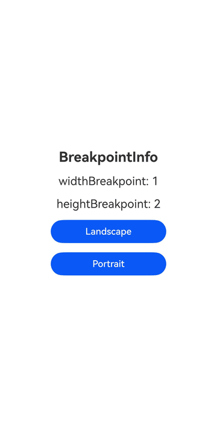
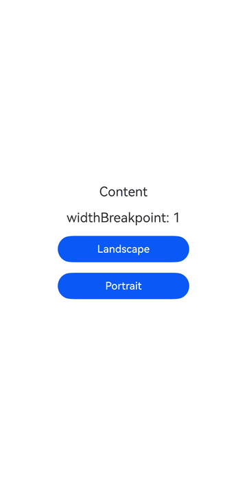

# \@Env: System Environment Variables


In ArkUI-X multi-device development, you can use the [\@Env](https://gitcode.com/openharmony/docs/blob/master/en/application-dev/reference/apis-arkui/arkui-ts/ts-env-system-property.md) decorator to obtain window breakpoint information and update the associated UI when the window size or screen orientation changes, enabling adaptive layouts.


## Overview

\@Env is a reactive system environment variable decorator that obtains and responds to window breakpoint changes.

- Uses [`SystemProperties.BREAK_POINT`](https://gitcode.com/openharmony/docs/blob/master/en/application-dev/reference/apis-arkui/arkui-ts/ts-env-system-property.md#systemproperties) to obtain window breakpoint information of the [`uiObserver.WindowSizeLayoutBreakpointInfo`](https://gitcode.com/openharmony/docs/blob/master/en/application-dev/reference/apis-arkui/js-apis-arkui-observer.md#windowsizelayoutbreakpointinfo22) type.
- When a system environment variable changes (for example, when the window size changes or the screen orientation switches), the \@Env decorated variable is notified to update, and the components associated with \@Env are refreshed, keeping the UI content up to date.
- Variables decorated by \@Env must not be initialized by developers. Their values are automatically provided by the framework based on the environment variables of the current window.


## Constraints

- \@Env can only be used in custom components decorated by [\@Component](arkts-create-custom-components.md) or [\@ComponentV2](https://gitcode.com/openharmony/docs/blob/master/en/application-dev/ui/state-management/arkts-create-custom-components.md#componentv2). Otherwise, a compile-time error occurs.
- When \@Env uses `SystemProperties.BREAK_POINT`, the decorated variable must be of the `uiObserver.WindowSizeLayoutBreakpointInfo` type. Otherwise, a compile-time error occurs.
- Variables decorated by \@Env are read-only. Initializing or assigning values to them is not allowed. Otherwise, a compile-time error occurs.

  ```ts
  import { uiObserver } from '@kit.ArkUI';

  @Entry
  @Component
  struct Index {
    // Incorrect: initializing an @Env decorated variable locally causes a compile-time error
    @Env(SystemProperties.BREAK_POINT) breakpoint: uiObserver.WindowSizeLayoutBreakpointInfo =
      new uiObserver.WindowSizeLayoutBreakpointInfo();

    build() {
    }
  }
  ```

- \@Env cannot be used together with other state variable decorators or \@Require. Otherwise, a compile-time error occurs.
- When an \@Env decorated variable is passed to a child component, the following rules apply.
  - When passed to a child component decorated by \@Component, it can only initialize regular variables in that child component.
  - When passed to a child component decorated by \@ComponentV2, it can only initialize variables decorated by [\@Param](https://gitcode.com/openharmony/docs/blob/master/en/application-dev/ui/state-management/arkts-new-param.md) of the child component.


## Application Scenarios

### Obtaining Window Breakpoint Information

When \@Env uses `SystemProperties.BREAK_POINT`, it returns the layout breakpoint information `WindowSizeLayoutBreakpointInfo` of the current window size, which contains the following attributes.

| Attribute | Type | Description |
| -------- | -------- | -------- |
| widthBreakpoint | [WidthBreakpoint](https://gitcode.com/openharmony/docs/blob/master/en/application-dev/reference/apis-arkui/arkui-ts/ts-appendix-enums.md#widthbreakpoint13) | Layout breakpoint enumeration for the window width. |
| heightBreakpoint | [HeightBreakpoint](https://gitcode.com/openharmony/docs/blob/master/en/application-dev/reference/apis-arkui/arkui-ts/ts-appendix-enums.md#heightbreakpoint13) | Layout breakpoint enumeration for the window height. |

In the following example, an \@Env decorated variable `breakpoint` is declared in \@Component, and its width and height breakpoint values are read in the build method. Tapping the `Landscape` and `Portrait` buttons switches the screen orientation. When the window size change causes a breakpoint change, the associated Text components refresh automatically.

[`UIUtils.addMonitor`](https://gitcode.com/openharmony/docs/blob/master/en/application-dev/ui/state-management/arkts-new-addMonitor-clearMonitor.md) listens for changes to the `widthBreakpoint` and `heightBreakpoint` properties. The `onBreakpointChange` callback logs the previous and current breakpoint values. When the component is destroyed, `UIUtils.clearMonitor` removes the registered listener.

```ts
import { uiObserver, UIUtils, window } from '@kit.ArkUI';
import { common } from '@kit.AbilityKit';

@Entry
@Component
struct Index {
  // The framework provides and updates breakpoint information for the current window.
  @Env(SystemProperties.BREAK_POINT) breakpoint: uiObserver.WindowSizeLayoutBreakpointInfo;

  // Switch the window orientation to demonstrate breakpoint updates after resizing.
  private changeOrientation(isLandscape: boolean) {
    const context = this.getUIContext().getHostContext() as common.UIAbilityContext;
    window.getLastWindow(context).then((lastWindow) => {
      lastWindow.setPreferredOrientation(
        isLandscape ? window.Orientation.LANDSCAPE : window.Orientation.PORTRAIT);
    });
  }

  onBreakpointChange(monitor: IMonitor) {
    // Read the previous and current breakpoint values for each changed property.
    monitor.dirty.forEach((path: string) => {
      console.info(`${path} changed from ${monitor.value(path)?.before} to ${monitor.value(path)?.now}`);
    });
  }

  aboutToAppear(): void {
    // Listen for changes to the width and height properties of the breakpoint object.
    UIUtils.addMonitor(this.breakpoint, ['widthBreakpoint', 'heightBreakpoint'], this.onBreakpointChange);
  }

  aboutToDisappear(): void {
    // Remove the listener registered in aboutToAppear when the component disappears.
    UIUtils.clearMonitor(this.breakpoint, ['widthBreakpoint', 'heightBreakpoint'], this.onBreakpointChange);
  }

  build() {
    Column({ space: 8 }) {
      // Reading breakpoint properties in build lets the Text components refresh on changes.
      Text(`widthBreakpoint: ${this.breakpoint.widthBreakpoint}`).fontSize(20)
      Text(`heightBreakpoint: ${this.breakpoint.heightBreakpoint}`).fontSize(20)

      Button('Landscape').width(200).onClick(() => {
        this.changeOrientation(true);
      })
      Button('Portrait').width(200).onClick(() => {
        this.changeOrientation(false);
      })
    }
    .width('100%')
    .padding(16)
  }
}
```


The running effect is shown below.



### Implementing Adaptive Layout with Breakpoints

In the following example, the sidebar and content area are displayed when the window width breakpoint is `WIDTH_MD` or higher. Otherwise, only the content area is displayed. The content area uses `layoutWeight(1)` to occupy the remaining width.

```ts
import { uiObserver, window } from '@kit.ArkUI';
import { common } from '@kit.AbilityKit';

@Entry
@Component
struct Index {
  // The framework provides and updates breakpoint information for the current window.
  @Env(SystemProperties.BREAK_POINT) breakpoint: uiObserver.WindowSizeLayoutBreakpointInfo;

  // Switch the window orientation to demonstrate breakpoint updates after resizing.
  private changeOrientation(isLandscape: boolean) {
    const context = this.getUIContext().getHostContext() as common.UIAbilityContext;
    window.getLastWindow(context).then((lastWindow) => {
      lastWindow.setPreferredOrientation(
        isLandscape ? window.Orientation.LANDSCAPE : window.Orientation.PORTRAIT);
    });
  }

  @Builder
  SideBar() {
    Column() {
      Text('SideBar').fontSize(20)
    }
    .width(200)
    .height('100%')
    .backgroundColor('#f1f1f1')
    .justifyContent(FlexAlign.Center)
  }

  @Builder
  Content() {
    Column({ space: 16 }) {
      Text('Content').fontSize(20)
      Text(`widthBreakpoint: ${this.breakpoint.widthBreakpoint}`).fontSize(20)

      Button('Landscape').width(200).onClick(() => {
        this.changeOrientation(true);
      })
      Button('Portrait').width(200).onClick(() => {
        this.changeOrientation(false);
      })
    }
    // The content area fills the remaining width beside the fixed-width sidebar.
    .layoutWeight(1)
    .height('100%')
    .justifyContent(FlexAlign.Center)
  }

  build() {
    Row() {
      if (this.breakpoint.widthBreakpoint >= WidthBreakpoint.WIDTH_MD) {
        // Show the sidebar and content area at WIDTH_MD and higher.
        this.SideBar()
        this.Content()
      } else {
        // Show only the content area at smaller width breakpoints.
        this.Content()
      }
    }
    .width('100%')
    // Set the demo area height. Breakpoints are determined by the window size.
    .height(240)
  }
}
```


The running effect is shown below.


