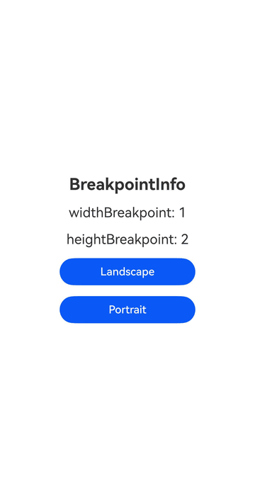
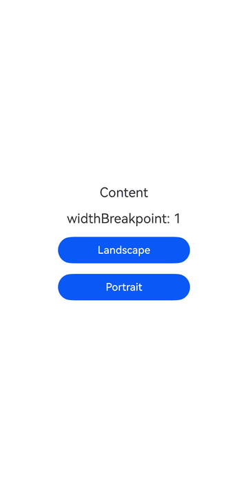

# \@Env：系统环境变量


在ArkUI-X多设备开发场景中，开发者可以使用[\@Env](https://gitcode.com/openharmony/docs/blob/master/zh-cn/application-dev/reference/apis-arkui/arkui-ts/ts-env-system-property.md)装饰器获取窗口断点信息，并在窗口尺寸或横竖屏变化时更新关联的UI，实现自适应布局。


## 概述

\@Env是响应式系统环境变量装饰器，可获取并响应窗口断点的变化。

- 通过[`SystemProperties.BREAK_POINT`](https://gitcode.com/openharmony/docs/blob/master/zh-cn/application-dev/reference/apis-arkui/arkui-ts/ts-env-system-property.md#systemproperties)获取窗口断点信息，类型为[`uiObserver.WindowSizeLayoutBreakpointInfo`](https://gitcode.com/openharmony/docs/blob/master/zh-cn/application-dev/reference/apis-arkui/js-apis-arkui-observer.md#windowsizelayoutbreakpointinfo22)。
- 系统环境变量改变时（如窗口尺寸变化、横竖屏切换），会通知\@Env装饰的变量更新，并触发\@Env关联组件刷新，以实现界面内容的同步更新。
- \@Env装饰的变量不允许开发者初始化，其值由框架根据当前窗口的环境变量自动提供。


## 限制条件

- \@Env仅支持在[\@Component](arkts-create-custom-components.md)和[\@ComponentV2](https://gitcode.com/openharmony/docs/blob/master/zh-cn/application-dev/ui/state-management/arkts-create-custom-components.md#componentv2)装饰的自定义组件中使用，否则会有编译时报错。
- \@Env使用`SystemProperties.BREAK_POINT`时，装饰的变量类型必须为`uiObserver.WindowSizeLayoutBreakpointInfo`类型，否则会有编译时报错。
- \@Env装饰的变量为只读属性，不允许开发者进行初始化或赋值操作，否则会有编译时报错。

  ```ts
  import { uiObserver } from '@kit.ArkUI';

  @Entry
  @Component
  struct Index {
    // 错误用法：@Env装饰的变量不允许本地初始化，编译时报错
    @Env(SystemProperties.BREAK_POINT) breakpoint: uiObserver.WindowSizeLayoutBreakpointInfo =
      new uiObserver.WindowSizeLayoutBreakpointInfo();

    build() {
    }
  }
  ```

- \@Env不能和其他状态变量装饰器或\@Require联用，否则会有编译时报错。
- \@Env装饰的变量向子组件传递时，需遵循以下规则。
  - 传递给\@Component装饰的子组件时，仅能用于初始化其中的常规变量（无装饰器修饰的变量）。
  - 传递给\@ComponentV2装饰的子组件时，仅能用于初始化其中[\@Param](https://gitcode.com/openharmony/docs/blob/master/zh-cn/application-dev/ui/state-management/arkts-new-param.md)装饰的变量。


## 使用场景

### 获取窗口断点信息

\@Env使用`SystemProperties.BREAK_POINT`时，返回当前窗口尺寸对应的布局断点信息`WindowSizeLayoutBreakpointInfo`，包含以下属性。

| 属性 | 类型 | 说明 |
| -------- | -------- | -------- |
| widthBreakpoint | [WidthBreakpoint](https://gitcode.com/openharmony/docs/blob/master/zh-cn/application-dev/reference/apis-arkui/arkui-ts/ts-appendix-enums.md#widthbreakpoint13) | 窗口宽度所在的布局断点枚举。 |
| heightBreakpoint | [HeightBreakpoint](https://gitcode.com/openharmony/docs/blob/master/zh-cn/application-dev/reference/apis-arkui/arkui-ts/ts-appendix-enums.md#heightbreakpoint13) | 窗口高度所在的布局断点枚举。 |

下面的示例中，在\@Component中声明\@Env装饰的变量`breakpoint`，并在build方法中读取其宽高断点值。点击`Landscape`和`Portrait`按钮切换横竖屏，窗口尺寸变化引起断点变化时，关联的Text组件自动刷新。

通过[`UIUtils.addMonitor`](https://gitcode.com/openharmony/docs/blob/master/zh-cn/application-dev/ui/state-management/arkts-new-addMonitor-clearMonitor.md)监听`widthBreakpoint`和`heightBreakpoint`属性的变化，`onBreakpointChange`回调打印变化前后的断点值。在组件销毁时，使用`UIUtils.clearMonitor`清理注册的监听。

```ts
import { uiObserver, UIUtils, window } from '@kit.ArkUI';
import { common } from '@kit.AbilityKit';

@Entry
@Component
struct Index {
  // 获取当前窗口的断点信息，值由框架提供并随窗口尺寸变化更新。
  @Env(SystemProperties.BREAK_POINT) breakpoint: uiObserver.WindowSizeLayoutBreakpointInfo;

  // 切换窗口方向，用于演示窗口尺寸变化时的断点更新。
  private changeOrientation(isLandscape: boolean) {
    const context = this.getUIContext().getHostContext() as common.UIAbilityContext;
    window.getLastWindow(context).then((lastWindow) => {
      lastWindow.setPreferredOrientation(
        isLandscape ? window.Orientation.LANDSCAPE : window.Orientation.PORTRAIT);
    });
  }

  onBreakpointChange(monitor: IMonitor) {
    // 遍历本次变化的属性，读取变化前后的断点值。
    monitor.dirty.forEach((path: string) => {
      console.info(`${path} changed from ${monitor.value(path)?.before} to ${monitor.value(path)?.now}`);
    });
  }

  aboutToAppear(): void {
    // 监听断点对象内部的宽高属性，属性变化时执行回调。
    UIUtils.addMonitor(this.breakpoint, ['widthBreakpoint', 'heightBreakpoint'], this.onBreakpointChange);
  }

  aboutToDisappear(): void {
    // 组件离开时清理对应监听，与aboutToAppear中的注册配对。
    UIUtils.clearMonitor(this.breakpoint, ['widthBreakpoint', 'heightBreakpoint'], this.onBreakpointChange);
  }

  build() {
    Column({ space: 8 }) {
      // 在build中读取断点属性，断点更新时关联的Text组件自动刷新。
      Text(`widthBreakpoint: ${this.breakpoint.widthBreakpoint}`).fontSize(20)
      Text(`heightBreakpoint: ${this.breakpoint.heightBreakpoint}`).fontSize(20)

      Button('Landscape').width(200).onClick(() => {
        this.changeOrientation(true);
      })
      Button('Portrait').width(200).onClick(() => {
        this.changeOrientation(false);
      })
    }
    .width('100%')
    .padding(16)
  }
}
```


运行效果图如下。



### 使用断点进行自适应布局

下面的示例中，当窗口宽度断点为`WIDTH_MD`及以上时，显示侧边栏和内容区，否则仅显示内容区。内容区使用`layoutWeight(1)`占据剩余宽度。

```ts
import { uiObserver, window } from '@kit.ArkUI';
import { common } from '@kit.AbilityKit';

@Entry
@Component
struct Index {
  // 获取当前窗口的断点信息，值由框架提供并随窗口尺寸变化更新。
  @Env(SystemProperties.BREAK_POINT) breakpoint: uiObserver.WindowSizeLayoutBreakpointInfo;

  // 切换窗口方向，用于演示窗口尺寸变化时的断点更新。
  private changeOrientation(isLandscape: boolean) {
    const context = this.getUIContext().getHostContext() as common.UIAbilityContext;
    window.getLastWindow(context).then((lastWindow) => {
      lastWindow.setPreferredOrientation(
        isLandscape ? window.Orientation.LANDSCAPE : window.Orientation.PORTRAIT);
    });
  }

  @Builder
  SideBar() {
    Column() {
      Text('SideBar').fontSize(20)
    }
    .width(200)
    .height('100%')
    .backgroundColor('#f1f1f1')
    .justifyContent(FlexAlign.Center)
  }

  @Builder
  Content() {
    Column({ space: 16 }) {
      Text('Content').fontSize(20)
      Text(`widthBreakpoint: ${this.breakpoint.widthBreakpoint}`).fontSize(20)

      Button('Landscape').width(200).onClick(() => {
        this.changeOrientation(true);
      })
      Button('Portrait').width(200).onClick(() => {
        this.changeOrientation(false);
      })
    }
    // 内容区占据剩余宽度，侧边栏使用固定宽度。
    .layoutWeight(1)
    .height('100%')
    .justifyContent(FlexAlign.Center)
  }

  build() {
    Row() {
      if (this.breakpoint.widthBreakpoint >= WidthBreakpoint.WIDTH_MD) {
        // WIDTH_MD及以上显示侧边栏和内容区。
        this.SideBar()
        this.Content()
      } else {
        // 较小宽度断点仅显示内容区。
        this.Content()
      }
    }
    .width('100%')
    // 设置布局演示区域的高度，断点信息取自整个窗口。
    .height(240)
  }
}
```


运行效果图如下。


