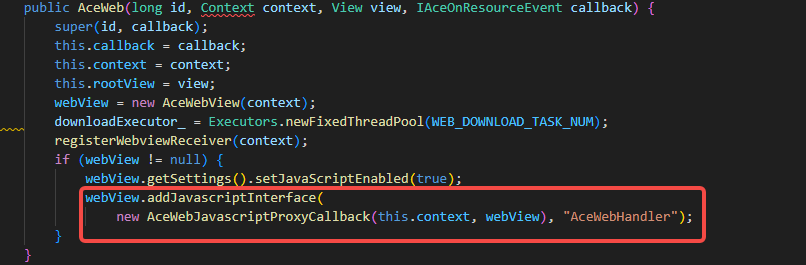
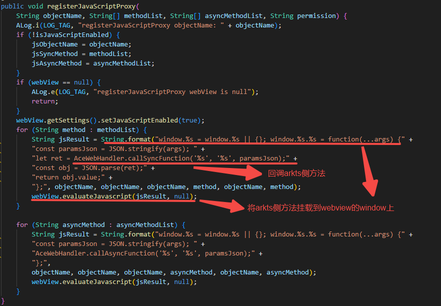
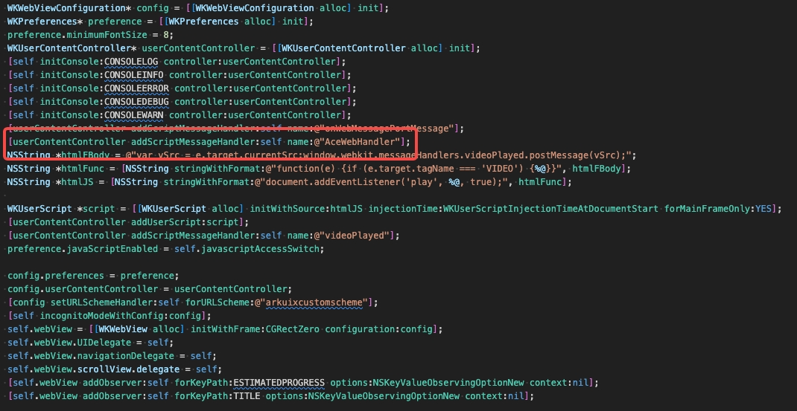
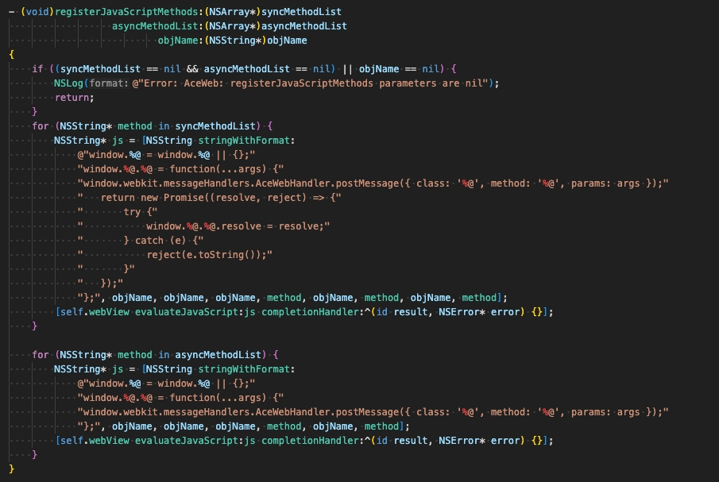

# 关于 registerJavaScriptProxy 使用说明


**调用该接口之前，Web 的 JS 环境必须已经准备就绪，否则注入的方法不会立即在当前页面生效。** 若在 JS 环境就绪前调用，框架会缓存注入配置，并在页面加载完成时自动完成挂载；为保证方法在当前页面及时可用，建议在 onPageEnd 或其之后调用该接口。

1：保证 WebView 的 JS 环境准备就绪：

Android 平台：

说明：

跨平台 ArkWeb 组件是通过桥接原生侧 WebView 来实现的。框架在 WebView 初始化时，通过原生平台 WebView 提供的 addJavascriptInterface 方法，将原生桥接对象以 AceWebHandler 为名挂载到 WebView 全局对象 window 上；调用 registerJavaScriptProxy 时，再通过原生平台 WebView 提供的 evaluateJavascript 方法，将 ArkTS 侧注册对象的方法包装函数挂载到 WebView 全局对象 window 上。H5 侧调用注册的方法时，包装函数内部通过框架挂载的原生 AceWebHandler 回调 ArkTS 侧注册的方法。方法挂载时，必须保证 JavaScript 上下文初始化完成，否则会导致方法挂载失败。

关键代码片段：

框架在 WebView 初始化时将原生桥接对象挂载到 WebView 全局对象 window 上（注入名为 AceWebHandler）：



调用 registerJavaScriptProxy 时，通过 evaluateJavascript 将方法包装函数挂载到 window 上，包装函数内部通过原生侧 AceWebHandler 回调 ArkTS 侧注册的方法：



调用接口：WebviewController 的 registerJavaScriptProxy(object: object, name: string, methodList: Array\<string>, asyncMethodList?: Array\<string>, permission?: string): void。

在 onPageEnd 或其之后调用该方法，能够保证注入类及其方法挂载到 window 对象上。

iOS 平台：

说明：

跨平台 ArkWeb 组件是通过桥接原生侧 WKWebView 来实现的。框架在 WKWebView 初始化时，通过原生平台 WKWebView 提供的 addScriptMessageHandler 方法注册名为 AceWebHandler 的脚本消息处理器（H5 侧通过 window.webkit.messageHandlers.AceWebHandler 访问）；调用 registerJavaScriptProxy 时，再通过原生平台 WKWebView 提供的 evaluateJavaScript 方法，将 ArkTS 侧注册对象的方法包装函数挂载到 WebView 全局对象 window 上。H5 侧调用注册的方法时，包装函数内部通过 window.webkit.messageHandlers.AceWebHandler.postMessage 将调用转发到原生侧，进而回调 ArkTS 侧注册的方法。方法挂载时，必须保证 JavaScript 上下文初始化完成，否则会导致方法挂载失败。

关键代码片段：

框架在 WKWebView 初始化时注册原生侧 AceWebHandler 脚本消息处理器：



调用 registerJavaScriptProxy 时，通过 evaluateJavaScript 将方法包装函数挂载到 window 上，包装函数内部通过 window.webkit.messageHandlers.AceWebHandler 回调 ArkTS 侧注册的方法：



调用接口：WebviewController 的 registerJavaScriptProxy(object: object, name: string, methodList: Array\<string>, asyncMethodList?: Array\<string>, permission?: string): void。

在 onPageEnd 或其之后调用该方法，能够保证注入类及其方法挂载到 window 对象上。

**注意：** 由于 WKWebView 原生仅支持异步调用，iOS 平台上注册为同步的方法在 H5 侧返回的是 Promise 对象，需要在调用时添加 await 以同步等待并获取返回值；异步方法没有返回值。

2：若需要在上述时机之前提前调用已注册的类和方法：

在 window 上的方法包装函数尚未挂载时（如页面加载过程中），H5 侧可通过框架挂载的桥接对象直接调用 ArkTS 侧已通过 registerJavaScriptProxy 注册的类和方法。

Android 平台：

在 H5 页面的 JS 代码中调用框架同步接口：AceWebHandler.callSyncFunction(className: String, methodName: String, paramsJson: String): String;

说明：AceWebHandler 是框架在 WebView 初始化时通过 addJavascriptInterface 注入 window 的原生桥接对象名。

参数说明：

| 参数       | 类型   | 说明                                                                                |
| ---------- | ------ | ---------------------------------------------------------------------------------- |
| className  | String | 注入的类名                                                                          |
| methodName | String | 注入的方法名                                                                        |
| paramsJson | String | 注入方法的参数列表（参数列表字符串是使用 JSON.stringify() 方法将参数数组序列化后的 JSON 串，数组元素与方法形参顺序一一对应，如 '["webtest data", 1]'；无参方法传 '[]'）  |

返回值说明：

返回值为 JSON 字符串，格式为 {"value": xxx}，需要使用 JSON.parse() 解析后取 .value 字段获得真正的返回值（框架内部包装函数即按此处理）；同步调用超时（1 秒）或执行异常时返回 {"value": null}。

说明：该接口一次只能调用一个方法（需同时指定类名和方法名）；若需要调用多个方法，需分别多次调用。

在 H5 页面的 JS 代码中调用框架异步接口：AceWebHandler.callAsyncFunction(className: String, methodName: String, paramsJson: String): void

参数说明：

| 参数       | 类型   | 说明                                                                                |
| ---------- | ------ | ---------------------------------------------------------------------------------- |
| className  | String | 注入的类名                                                                          |
| methodName | String | 注入的方法名                                                                        |
| paramsJson | String | 注入方法的参数列表（参数列表字符串是使用 JSON.stringify() 方法将参数数组序列化后的 JSON 串，数组元素与方法形参顺序一一对应，如 '["webtest data", 1]'；无参方法传 '[]'）  |

说明：该接口一次只能调用一个方法（需同时指定类名和方法名）；若需要调用多个方法，需分别多次调用。此函数没有返回值。

H5 页面 JS 调用示例：

```javascript
// 前提：ArkTS 侧已完成注册，例如：
// this.controller.registerJavaScriptProxy(this.testObj, "objName", ["test"], ["asyncTest"]);
// 其中 TestObj 定义了同步方法 test(str: string, num: number): string 和异步方法 asyncTest(str: string): void。

// 同步调用：paramsJson 为参数数组序列化后的 JSON 串，参数顺序与方法形参一致
const ret = AceWebHandler.callSyncFunction('objName', 'test', '["webtest data", 1]');
const result = JSON.parse(ret).value; // 真正的返回值，即 test 方法的返回结果

// 异步调用：没有返回值
AceWebHandler.callAsyncFunction('objName', 'asyncTest', '["async test data"]');

// 无参方法：paramsJson 传 '[]'
AceWebHandler.callSyncFunction('objName', 'toString', '[]');
```

iOS 平台：

在 H5 页面的 JS 代码中调用框架接口：window.webkit.messageHandlers.AceWebHandler.postMessage({ class: String, method: String, params: String });

参数说明：

| 参数   | 类型   | 说明                                                                                |
| ------ | ------ | ---------------------------------------------------------------------------------- |
| class  | String | 注入的类名                                                                          |
| method | String | 注入的方法名                                                                        |
| params | String | 注入方法的参数列表（参数列表字符串是使用 JSON.stringify() 方法将参数数组序列化后的 JSON 串，数组元素与方法形参顺序一一对应，如 '["webtest data", 1]'；无参方法传 '[]'）  |

说明：该接口一次只能调用一个方法（需同时指定类名和方法名）；若需要调用多个方法，需分别多次调用。

H5 页面 JS 调用示例：

```javascript
// 前提：ArkTS 侧已完成注册，例如：
// this.controller.registerJavaScriptProxy(this.testObj, "objName", ["test"], []);
// 其中 TestObj 定义了同步方法 test(str: string, num: number): string。

// params 为参数数组序列化后的 JSON 串，参数顺序与方法形参一致
window.webkit.messageHandlers.AceWebHandler.postMessage({ class: 'objName', method: 'test', params: '["webtest data", 1]' });

// 注意：此直接调用方式无法获取返回值。若需获取同步方法的返回值，
// 需在包装函数挂载到 window 后通过 await objName.test("webtest data", 1) 调用获取。
```
