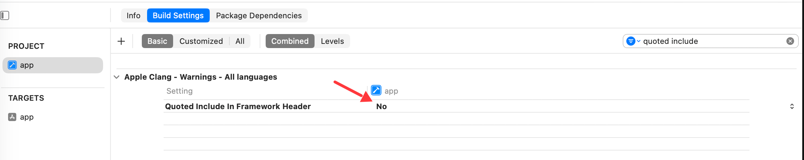
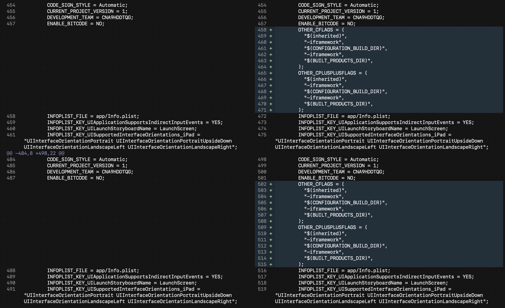

## ArkUI-X iOS 编译提示 double-quoted include 警告

### 问题现象

iOS 工程集成 ArkUI-X SDK（`libarkui_ios.xcframework`）后编译，Xcode 输出如下告警：

```text
.../libarkui_ios.xcframework/ios-arm64/libarkui_ios.framework/Headers/include/ace/xcomponent/native_type.h:57:10: warning: double-quoted include "node_attributes/image.h" in framework header, expected angle-bracketed instead [-Wquoted-include-in-framework-header]
   57 | #include "node_attributes/image.h"
      |          ^~~~~~~~~~~~~~~~~~~~~~~~~
      |          <libarkui_ios/include/ace/xcomponent/node_attributes/image.h>
```

### 问题原因

SDK framework 头文件中使用双引号（`"..."`）方式包含同目录头文件，Xcode 针对 framework header 的包含方式会给出 `-Wquoted-include-in-framework-header` 告警。该告警不影响编译产物和功能运行。

### 解决办法

可根据实际构建方式选择以下方案消除该告警。

#### 方式一：消除 Xcode 编译告警（关闭告警项）

修改 Xcode 构建设置，关闭该告警项：

1. 在 Xcode 左侧导航栏中，点击项目根节点。
2. 在中间编辑区的 TARGETS 列表中，选中应用 Target（例如 app）。
3. 切换到顶部的 **Build Settings** 标签页。
4. 在右上角的搜索框中输入 `quoted include`。
5. 找到 **Apple Clang - Warning - All Languages** 分组下的 **Quoted Include In Framework Header** 设置项。
6. 将其值从 `Yes` 修改为 `No`。



设置完成后重新编译，该 Target 就不会再产生此警告。

说明：该方式会同时关闭业务代码中的 `-Wquoted-include-in-framework-header` 告警；如果希望只抑制 SDK 头文件告警，使用方式二。

#### 方式二：消除 ace tools 命令行和 IDE 编译告警

在 ace tools 命令行或 IDE 编译场景下，可在工程生成的 `.arkui-x/ios/app.xcodeproj/project.pbxproj` 的 Debug 和 Release 两个 Target 配置中，在 `ENABLE_BITCODE = NO;` 后添加以下配置。

```text
OTHER_CFLAGS = (
    "$(inherited)",
    "-iframework",
    "$(CONFIGURATION_BUILD_DIR)",
    "-iframework",
    "$(BUILT_PRODUCTS_DIR)",
    "-isystem",
    "$(SRCROOT)/frameworks/libarkui_ios.xcframework/ios-arm64/libarkui_ios.framework/Headers/include",
);
OTHER_CPLUSPLUSFLAGS = (
    "$(inherited)",
    "-iframework",
    "$(CONFIGURATION_BUILD_DIR)",
    "-iframework",
    "$(BUILT_PRODUCTS_DIR)",
    "-isystem",
    "$(SRCROOT)/frameworks/libarkui_ios.xcframework/ios-arm64/libarkui_ios.framework/Headers/include",
);
```

在 `project.pbxproj` 中添加 `-iframework` 的 diff 示例如下：



说明：

- `-F` 是普通 framework 搜索路径，`-iframework` 是 system framework 搜索路径。同一目录同时通过两者被搜索时，Clang 会将其中 framework 的头文件按 system header 处理，`-Wquoted-include-in-framework-header`、`-Wdocumentation`、`-Wnullability-completeness` 等 SDK 头文件告警不再产生。
- `-isystem` 将 SDK 的 `Headers/include` 目录标记为 system header 搜索路径，适用于 native C/C++ 代码通过该目录包含 SDK 头文件的场景。路径中的 `ios-arm64` 需与实际构建产物目录保持一致。
- 该方式只抑制 SDK 头文件告警，不会关闭业务代码中的同类告警。

修改完成后重新编译工程，SDK 头文件告警不再产生。
